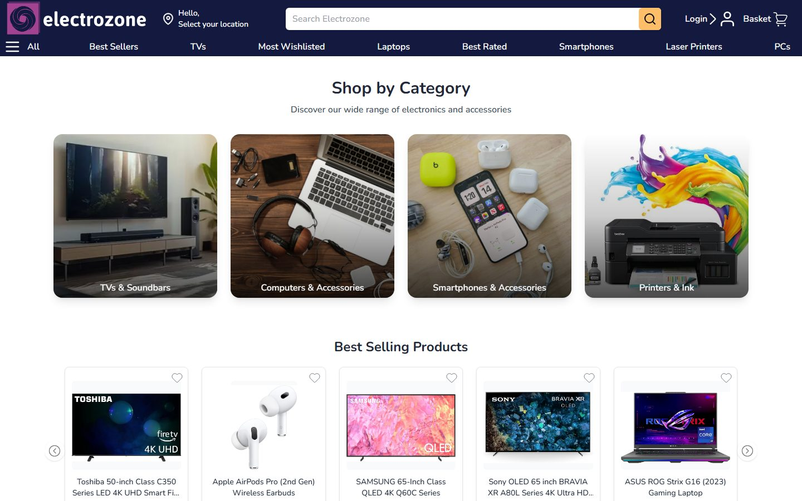
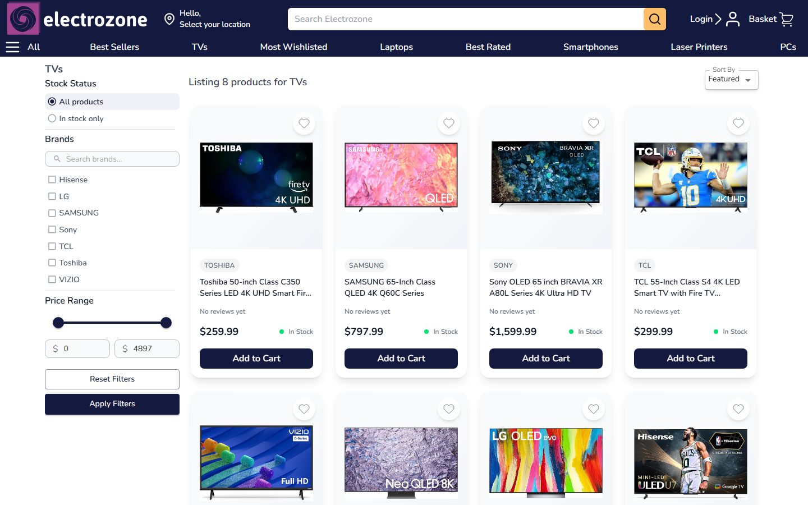
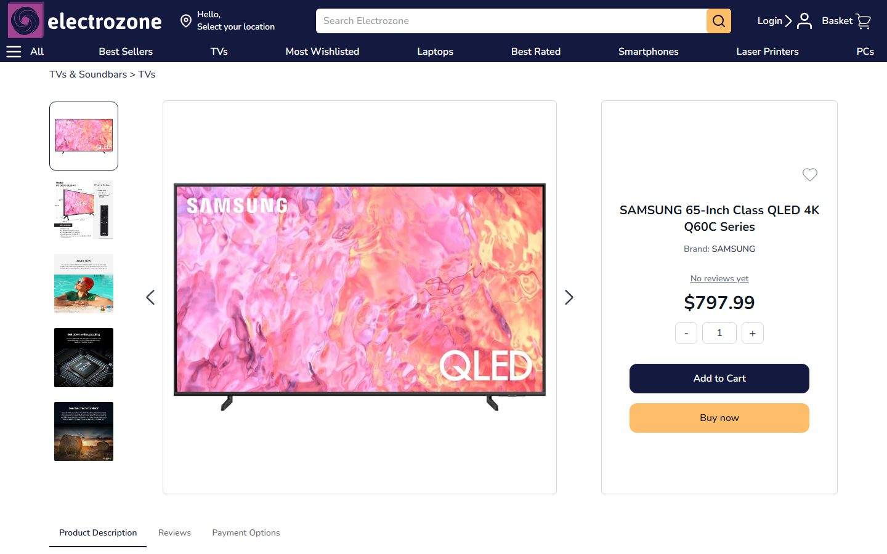
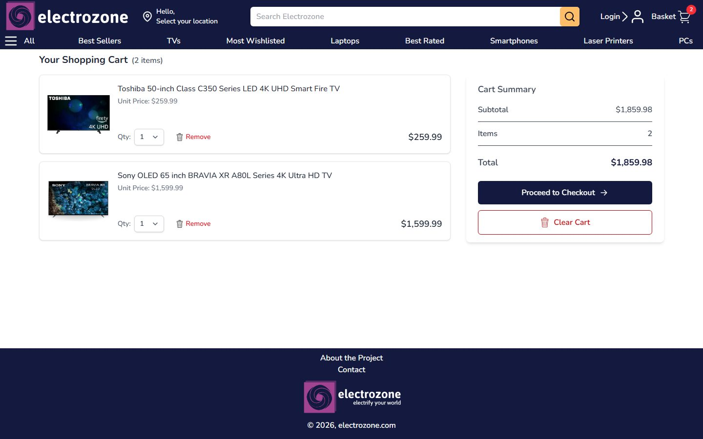
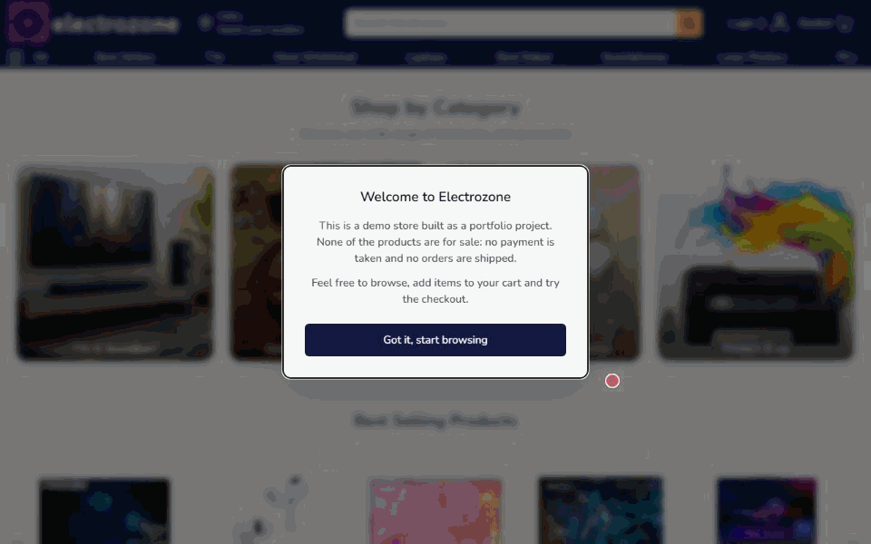

# Electrozone

A full-stack electronics store built with React and TypeScript. Shoppers can browse and filter products, check out as a guest or with an account, track and cancel orders, keep a wishlist and review products they have bought.

**Live demo:** [electrozone.netlify.app](https://electrozone.netlify.app) · **Backend:** [electrozone-server](https://github.com/KutayAraz/electrozone-server) (NestJS, MySQL, Redis)



<table>
  <tr>
    <td><br><sub>Product listing with filters</sub></td>
    <td><br><sub>Product page</sub></td>
  </tr>
  <tr>
    <td><br><sub>Guest shopping cart</sub></td>
    <td align="center"><br><sub>Mobile layout</sub></td>
  </tr>
</table>



## Features

- **Browsing and search:** category and subcategory pages, product search, and filters for brand, price range and stock status.
- **Carts:** a guest cart that carries over when the shopper signs in, an account cart, and a separate "Buy now" flow for a single product. Price and stock changes are flagged before checkout.
- **Orders:** checkout, an order history with infinite scroll, and cancellation within 24 hours of ordering.
- **Wishlist and reviews:** a wishlist synced to the account, and ratings and reviews limited to customers who bought the product.
- **Trending products:** best sellers, most wishlisted and best rated products on the home page.
- **Accounts:** registration, login, profile and password management.

## Technical highlights

- **Data fetching with RTK Query.** Endpoints are injected per feature into one base API, and cache tags keep the cart, wishlist, stock and review data in sync after every mutation.
- **Silent session renewal.** Authentication uses HTTP-only cookies. When a request fails with a 401, the base query refreshes the token and retries the request. A mutex makes sure only one refresh runs at a time, and other requests wait for it ([refresh-auth.ts](src/lib/api/refresh-auth.ts)).
- **Route-level code splitting.** Every page is lazy-loaded through React Router data loaders, and slower sections such as the home page carousels stream in with `Suspense` and `Await`.
- **Central error handling.** One Redux middleware turns failed API calls into user-facing notifications ([error-middleware.ts](src/lib/api/error-middleware.ts)), and route error boundaries keep the header and footer usable when a page fails.
- **Feature-based structure.** Code is grouped by feature under `src/features`, and ESLint enforces the import boundaries between layers and blocks circular dependencies.
- **Forms.** react-hook-form with Zod schemas for validation.
- **Persistence.** redux-persist keeps the session, wishlist and "Buy now" state across reloads.
- **SEO.** Per-page titles and descriptions with react-helmet-async, plus Open Graph tags, a sitemap and robots.txt.

## Tech stack

| Area          | Tools                                                  |
| ------------- | ------------------------------------------------------ |
| Framework     | React 18, TypeScript, Vite                             |
| State & data  | Redux Toolkit, RTK Query, redux-persist                |
| Routing       | React Router (data routers, lazy routes)               |
| Forms         | react-hook-form, Zod                                   |
| Styling       | Tailwind CSS, Material UI                              |
| Testing       | Vitest, Testing Library, Playwright                    |
| Tooling       | ESLint, Prettier                                       |
| Hosting       | Netlify (frontend), Render (backend)                   |

## Project structure

```text
src/
├── app/         # Router and app-wide providers
├── components/  # Shared UI components
├── config/      # Route paths
├── features/    # Feature modules (auth, cart, checkout, orders, products, wishlist, ...)
├── hooks/       # Shared hooks
├── layouts/     # Page layouts (header, footer)
├── lib/         # API client, auth refresh and error middleware
├── pages/       # Route components
├── stores/      # Redux store and global slices
├── types/       # Shared types
└── utils/       # Shared helpers
```

## Getting started

### Prerequisites

- Node.js 22.13 or later (see `.nvmrc`)
- A running instance of the [backend](https://github.com/KutayAraz/electrozone-server)

### Setup

```sh
git clone https://github.com/KutayAraz/electrozone-client.git
cd electrozone-client
npm install
cp .env.example .env.development
npm run dev
```

### Environment variables

| Variable                    | Description                                          |
| --------------------------- | ---------------------------------------------------- |
| `VITE_API_URL`              | Base URL of the backend API, e.g. `http://localhost:3000/api` |
| `VITE_WEB3FORMS_ACCESS_KEY` | Web3Forms access key for the contact form            |

### Scripts

| Command            | Description                          |
| ------------------ | ------------------------------------ |
| `npm run dev`      | Start the development server         |
| `npm run build`    | Type-check and build for production  |
| `npm run preview`  | Preview the production build         |
| `npm run lint`     | Run ESLint                           |
| `npm test`         | Run tests in watch mode              |
| `npm run test:run` | Run tests once                       |
| `npm run test:e2e` | Run the Playwright end-to-end tests  |

The end-to-end tests need the backend running and a test account on it. Copy `.env.e2e.example` to `.env.e2e` and fill in that account's email and password. Run `npx playwright install chromium` once to download the browser.

## Contact

Kutay Araz · [kutayaraz@gmail.com](mailto:kutayaraz@gmail.com) · [GitHub](https://github.com/KutayAraz)
